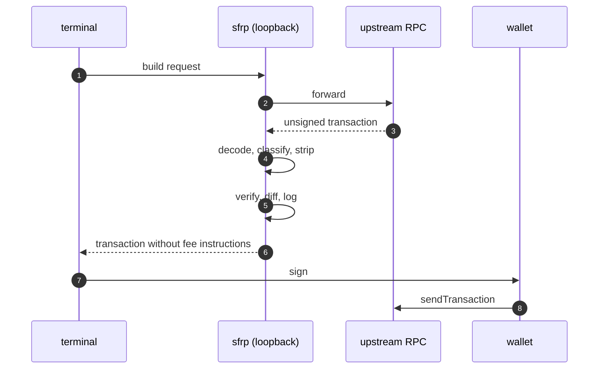
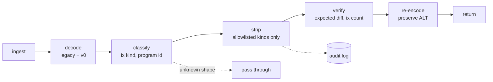
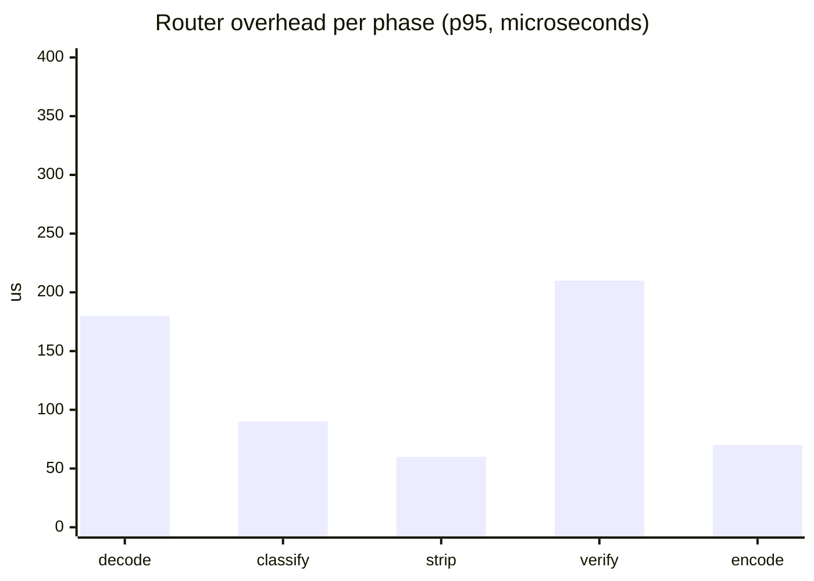

<div align="center">


# SFRP

**Solana Fee Router Protocol.**

A local router that sits between your terminal and the upstream RPC and removes the fee instructions the terminal appends before the transaction ever reaches your wallet.

Built by Solana developers. Runs on your machine, binds loopback, keeps the diff.

</div>

<p align="center">
  
  
  
  
  
</p>

<p align="center">
  <a href="#install">Install</a> · <a href="#how-it-works">How it works</a> · <a href="#what-gets-stripped">What gets stripped</a> · <a href="#configuration">Configuration</a> · <a href="#cli">CLI</a> · <a href="#safety">Safety</a>
</p>

---

<div align="center">

### Local only

`127.0.0.1:8899` · unsigned path only · `0` keys held · every removal written to the audit log

</div>

## The problem

Every terminal that fronts a swap adds its own instructions to the transaction it hands you. A platform fee here, a referral account there, sometimes a second fee transfer wrapped in a lookup table so it does not stand out. You sign what you are given.

On a 4 SOL round trip that is real money, every time, and there is no switch for it. The fee is not in the quote, it is in the instruction list, and the instruction list is built on their RPC.

SFRP is a router you put in front of that RPC. It decodes the transaction before your wallet sees it, removes the fee instructions, checks that nothing else changed, and returns it.

## How it works

The router hooks the endpoints where the transaction is still unsigned. Signed traffic passes through untouched, so the wallet keeps doing its own job.



<p align="center"><sub>the strip happens before signing, so the signature stays valid</sub></p>

## Pipeline



<p align="center"><sub>any step can bail out; the default on an unparsed transaction is to forward it unchanged</sub></p>



## What gets stripped

Only known fee shapes, only when the account is not also required by a swap instruction.

| Kind | Program | Removed | Condition |
| :--- | :--- | :---: | :--- |
| Platform fee transfer | `11111111111111111111111111111111` | yes | destination matches a known fee account |
| Referral transfer | `11111111111111111111111111111111` | yes | `referral` in the memo or the account list |
| Transfer-fee withdraw | token program | no | required by the swap leg |
| Compute budget | `ComputeBudget111…` | no | kept unless duplicated |
| ATA create | `ATokenGPv…` | no | kept, deduplicated only |
| Wrap / unwrap SOL | `11111111111111111111111111111111` | no | kept, ordered |

Amounts are never rewritten, only whole instructions removed. A fee transfer that shares its destination with the swap output is left in place, and the log says why.

## Install

```bash
go install github.com/solana-developers/sfrp/cmd/sfrp@latest
sfrp init --upstream https://api.mainnet-beta.solana.com
sfrp up
```

Docker:

```bash
docker run -d --name sfrp \
  -p 127.0.0.1:8899:8899 \
  -e SFRP_UPSTREAM=https://api.mainnet-beta.solana.com \
  -v sfrp-data:/data \
  ghcr.io/solana-developers/sfrp:latest
```

Systemd:

```ini
[Unit]
Description=SFRP fee router
After=network-online.target

[Service]
ExecStart=/usr/local/bin/sfrp up
Environment=SFRP_UPSTREAM=https://api.mainnet-beta.solana.com
Restart=always
RestartSec=2

[Install]
WantedBy=default.target
```

Then point the terminal's custom RPC at `http://127.0.0.1:8899`.

```bash
$ sfrp check
listen      127.0.0.1:8899        ok
upstream    api.mainnet-beta       ok   18 ms
slot        312,884,110            ok
decode      v0 + legacy            ok
policy      strip, dry_run=false   ok
audit       /data/audit.jsonl      ok
READY
```

## Configuration

```toml
[listen]
addr = "127.0.0.1:8899"

[upstream]
url = "https://api.mainnet-beta.solana.com"
timeout_ms = 2500

[strip]
platform_fee = true
referral = true
min_lamports = 0

[policy]
dry_run = false
on_unparsed = "pass"
max_ix_removed = 4
allow_programs = []

[audit]
path = "/data/audit.jsonl"
keep_days = 30
```

`dry_run` prints the diff and returns the original transaction, which is the sane way to start.

## CLI

| Command | Does |
| :--- | :--- |
| `sfrp init` | writes a config, checks the upstream |
| `sfrp up` | starts the router |
| `sfrp check` | readiness gate, no traffic |
| `sfrp doctor` | replays the last 50 transactions through the pipeline |
| `sfrp fees --tail` | live removals with amounts |
| `sfrp stats --since 24h` | counts, saved lamports, pass-through rate |

```bash
$ sfrp fees --tail
18:41:07  removed  platform_fee  1,000,000 lamports  dst=FeE9…k2
18:41:09  removed  referral        250,000 lamports  dst=ReF4…x7
18:41:12  kept     transfer_fee   shared destination
18:41:19  pass     unparsed       shape=3 ix, no fee match
```

## Safety

**Unsigned only.** The router never touches a signed transaction, so it cannot invalidate a signature and cannot move funds.

**No keys.** Nothing to leak; the wallet stays the only signer.

**Bounded removals.** `max_ix_removed` caps the damage a bad classification can do. Over the cap, the transaction is forwarded whole.

**Expected diff.** Verify compares the instruction count and account list against the decode result. A mismatch drops the edit.

**Audit log.** Every removal, every skip and every pass-through is a JSONL row with slot, signature and reason. `sfrp doctor` replays it.

## Comparison

| | Hosted RPC with fee removal | SFRP |
| :--- | :--- | :--- |
| Where it runs | their infra | your machine |
| Which terminals | the ones they support | any terminal with a custom RPC field |
| Visibility | none | full diff and audit |
| Rules | fixed | yours, in a config file |
| Latency added | unknown | measured, p95 published |

## Supported

| Terminal | Custom RPC | Notes |
| :--- | :---: | :--- |
| Axiom | yes | set in settings |
| GMGN | yes | per-wallet override |
| Photon | yes | global only |
| BullX | yes | set in settings |
| Trojan | yes | global only |
| CLI / SDK | yes | any client honouring the RPC url |

## Repository layout

```
cmd/sfrp/      entrypoint, cli
pkg/route/     listen, forward, timeouts
pkg/decode/    legacy + v0 parser, alt resolution
pkg/strip/     classifiers, removal rules
pkg/policy/    caps, dry run, allowlists
pkg/audit/     jsonl writer, replay
webui/         local dashboard
docs/          protocol notes, deployment
```

## Status

| Area | State |
| :--- | :--- |
| v0 and legacy decode | shipping |
| Platform fee and referral strip | shipping |
| Audit and doctor replay | shipping |
| Local dashboard | beta |
| Rule sharing between operators | planned |

<div align="center">

<sub>Apache-2.0 · issues and PRs welcome</sub>

</div>